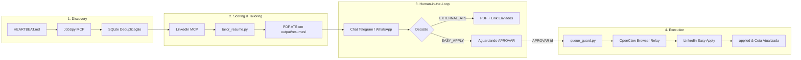

# Claw Vagas Bot


Agente de IA que acha vagas no LinkedIn, mede o fit, gera um currículo sob medida e se candidata via Easy Apply, **sempre com a sua aprovação no Telegram**. Projeto pessoal em Python, com 229 testes automatizados.

## O problema e a abordagem

Candidatar-se a dezenas de vagas por semana é repetitivo, mas entregar isso a um agente autônomo é arriscado: ele pode inventar respostas, mandar um currículo errado ou queimar sua conta. O projeto trata essas falhas como requisitos de engenharia, não como detalhes.

| Decisão de projeto | Por quê |
| :--- | :--- |
| **Anti-alucinação:** respostas de triagem saem só de uma base declarada pelo usuário. Pergunta desconhecida pausa a vaga (`needs_input`), pergunta no Telegram e aprende a resposta. | Um LLM que "completa" lacunas mente em candidatura. O agente nunca preenche o que não sabe. |
| **Humano no loop:** nada é enviado sem `APROVAR` no Telegram. O bot atende só o chat autorizado. | A decisão de candidatura é do usuário. O agente prepara, não decide. |
| **Máquina de estados explícita** (`discovered` até `applied`, com `needs_input` e `failed`). | Qualquer falha deixa a vaga num estado conhecido e recuperável, sem envio duplicado. |
| **Currículo verificável:** só cita tecnologias presentes no perfil do usuário. | O PDF sob medida não pode afirmar o que o usuário não tem. |
| **Limites de segurança sem bypass:** teto diário, janela de horário e intervalo aleatório entre envios. | Protege a conta do usuário. Não há opção `--force`. |
| **Percepção da tela com plano B:** leitura da árvore de acessibilidade e, se falhar, visão por modelo. | O LinkedIn muda o HTML, então a automação precisa degradar sem quebrar. |
| **Dados pessoais fora do git:** perfil, respostas e banco ficam locais; o repositório traz só arquivos `*.example`. | Segurança por padrão em um projeto que lida com dados sensíveis. |

**Stack:** Python, SQLite, Playwright (Browser Relay), Telegram Bot API, Jinja2 e WeasyPrint/Chrome (PDF), pytest.

> Uso pessoal e educacional. Automatizar o LinkedIn pode violar os termos da plataforma, então use por sua conta e risco.

---

## Documentação técnica

Workspace completo e modular projetado para rodar **diretamente dentro do runtime oficial do OpenClaw** (`~/.openclaw/`), automatizando a descoberta de vagas no LinkedIn, cálculo de fit técnico, geração de currículo ATS em PDF sob medida, curadoria humana via chat (Telegram/WhatsApp) e candidatura assistida (*Easy Apply*) com o **OpenClaw Browser Relay**.

---

## 🏗️ Arquitetura Nativa em 4 Estágios



1. **Estágio 1 — Descoberta Off-Account (`Discovery`):**
   - Disparado pelo cron enxuto em `HEARTBEAT.md` (< 50 linhas).
   - Busca vagas no LinkedIn usando `job-search-mcp-jobspy` sem expor a conta do usuário.
   - Deduplica imediatamente consultando `workspace/db/jobs.db` via MCP `sqlite`.

2. **Estágio 2 — Enriquecimento e Tailoring (`skills/job-curator/SKILL.md`):**
   - Extrai requisitos completos com `stickerdaniel/linkedin-mcp-server` e classifica entre `EASY_APPLY` e `EXTERNAL_ATS`.
   - Calcula `match_score` (0 a 100) contra `workspace/data/profile.json`.
   - Se `match_score >= 75`, executa `workspace/scripts/tailor_resume.py` gerando `output/resumes/<job_id>.pdf` (layout limpo em coluna única para ATS via Jinja2 + WeasyPrint/Chrome).

3. **Estágio 3 — Curadoria no Chat Nativo do OpenClaw:**
   - Despacha mensagem estruturada no Telegram/WhatsApp com Cargo, Empresa, Local, Match Score, Top 3 motivos de aderência e Gaps.
   - Se `EXTERNAL_ATS`: anexa o PDF customizado e o link direto; define status `notified_external`.
   - Se `EASY_APPLY`: define status `pending_approval` e aguarda aprovação humana.

4. **Estágio 4 — Candidatura no Chrome Local (`skills/linkedin-easy-apply/SKILL.md`):**
   - Ao receber `APROVAR <job_id>`, valida limites de segurança via `workspace/scripts/queue_guard.py`.
   - Usa o **OpenClaw Browser Relay** conectado ao Google Chrome local.
   - Valida existência pré-submit do PDF, preenche perguntas eliminatórias consultando estritamente `workspace/data/EXPERIENCE_ANSWERS.md`, desmarca a opção de seguir a empresa e finaliza a candidatura.
   - Atualiza a cota diária em `daily_quotas` e confirma o envio no chat.

---

## 🛡️ Guardrails Anti-Bloqueio e Proteção de Conta

- **Trava contra Alucinação (`needs_input`):** Se surgir qualquer pergunta no modal cujo valor não conste em `EXPERIENCE_ANSWERS.md`, o agente **pausa imediatamente**, marca `needs_input`, envia a pergunta no chat e só conclui após o usuário responder (atualizando a base).
- **Sem Bypass:** As travas não têm opção de `--force`; só vagas com status `approved` são executadas.
- **Envio Confirmado:** O status só vira `applied` com a confirmação do LinkedIn na tela. Sem PDF anexado, nada é enviado.
- **Foco em Easy Apply:** Com `EASY_APPLY_ONLY=1` (padrão no `.env`), a busca usa só o LinkedIn com o filtro Easy Apply. Vagas externas não aparecem nas sugestões nem podem ser aprovadas. Se uma vaga se revelar externa ao abrir a página, é pulada sem consumir a cota. Use `0` para incluir Indeed e portais de empresas.
- **Chat Autorizado:** O bot atende somente `TELEGRAM_CHAT_ID`.
- **Teto Diário:** Limite padrão de 15 candidaturas por dia registrado na tabela `daily_quotas`.
- **Jitter Humano:** Intervalo aleatório obrigatório de 180 a 300 segundos entre candidaturas.
- **Janela Operacional:** Execução restrita ao horário comercial (08:00 às 20:00).
- **Verificação Pré-Submit:** O PDF de `output/resumes/<job_id>.pdf` é gerado e validado antes de abrir o navegador.
- **Conteúdo Verificável:** O currículo cita apenas tecnologias presentes em `profile.json`.

---

## 📁 Estrutura de Arquivos

```text
├── config/
│   └── openclaw.mcp.patch.json         # Configuração MCP nativa (mcp.servers)
├── setup.sh                            # Script automatizado de instalação no ~/.openclaw/
├── workspace/
│   ├── IDENTITY.md                     # Nome e metadados do agente
│   ├── SOUL.md                         # Personalidade e limites inegociáveis
│   ├── AGENTS.md                       # Instruções operacionais e máquina de estados
│   ├── USER.md                         # Perfil fixo e critérios do candidato
│   ├── TOOLS.md                        # Caminhos exatos de scripts e banco SQLite
│   ├── HEARTBEAT.md                    # Checklist cron enxuto (< 50 linhas)
│   ├── skills/
│   │   ├── job-curator/
│   │   │   └── SKILL.md                # Skill de descoberta, scoring e envio ao chat
│   │   └── linkedin-easy-apply/
│   │       └── SKILL.md                # Skill de preenchimento via Browser Relay
│   ├── db/
│   │   └── schema.sql                  # Schema SQLite (jobs, application_logs, daily_quotas)
│   ├── data/
│   │   ├── profile.json                # Perfil profissional estruturado
│   │   └── EXPERIENCE_ANSWERS.md       # Matriz estrita para triagem do Easy Apply
│   ├── templates/
│   │   └── resume_ats.html             # Template HTML/CSS de coluna única para ATS
│   └── scripts/
│       ├── common.py                   # Config (.env), Telegram e normalização de vagas
│       ├── telegram_bot.py                 # Bot e worker da fila de candidaturas
│       ├── apply_job.py                    # Candidatura via OpenClaw Browser Relay
│       ├── migrate_db.py                   # Migração idempotente do jobs.db (com backup)
│       ├── init_db.py                  # Inicializador do SQLite e diretórios
│       ├── tailor_resume.py            # Motor de personalização de currículo e PDF
│       └── queue_guard.py              # Controlador de segurança e cotas anti-ban
└── README.md
```

---

## 🚀 Instalação e Ativação

### 0. Configuração Local (dados fora do git)
1. Copie `workspace/.env.example` para `workspace/.env` e preencha `TELEGRAM_BOT_TOKEN` e `TELEGRAM_CHAT_ID`.
2. Em `workspace/` e `workspace/data/`, copie os arquivos `*.example.*` removendo `.example` e preencha com seus dados.
3. Bancos existentes: rode `python workspace/scripts/migrate_db.py` (cria backup automático).

Testes: `python -m pytest tests`. Eles usam apenas os dados de exemplo e não acessam a rede.

### 1. No Windows (PowerShell)
No PowerShell, execute diretamente o script nativo:
```powershell
powershell -ExecutionPolicy Bypass -File .\setup.ps1
```
*(Nota: no Windows PowerShell os comandos Unix `chmod` não são necessários nem reconhecidos).*

---

### 2. No Linux, macOS ou Git Bash / WSL
No terminal Unix ou Git Bash:
```bash
chmod +x setup.sh
./setup.sh
```

O script de instalação:
- Cria a estrutura de pastas em `~/.openclaw/workspace/` (ou `C:\Users\<Usuario>\.openclaw\workspace\`).
- Configura o ambiente virtual Python em `.venv` com `jinja2` e `weasyprint`.
- Inicializa o banco `db/jobs.db` com o schema relacional e cota diária de 15 candidaturas.
- Mescla a configuração dos 4 servidores MCP no arquivo `openclaw.json`.
- Executa diagnósticos de validação do OpenClaw.

### 2. Conectar a Extensão OpenClaw Browser Relay no Chrome
1. Abra o Google Chrome no seu computador e faça login normalmente na sua conta do LinkedIn.
2. Certifique-se de que a extensão oficial **OpenClaw Browser Relay** está instalada e ativa.
3. Clique no ícone da extensão e certifique-se de que o status indica *"Connected to OpenClaw"*.

### 3. Comandos de Interação no Chat (Telegram / WhatsApp)
Com o OpenClaw ativo, envie diretamente no chat conectado:
- `APROVAR <job_id>`: Autoriza a candidatura assistida para a vaga informada.
- `PULAR <job_id>`: Descarta a vaga.
- Resposta a `needs_input`: Use os botões da pergunta ou toque em "Digitar resposta". A resposta é salva e a candidatura recomeça do início.
- `STATUS`: Retorna o relatório completo de cotas diárias, vagas na fila e auditoria.
- Vaga externa: envie no site da empresa e toque em "✅ Já me candidatei" no kit recebido. Ela passa a contar no `/resultados` sem consumir a cota diária.
- `/resultados`: Registra o que aconteceu após o envio (resposta, entrevista, recusa ou sem retorno). O painel mostra o retorno por faixa de Fit.

### 4. Validar o Modal sem Enviar
Antes de liberar a fila, teste uma vaga aprovada. O comando percorre o modal e anexa o PDF, mas para antes de enviar:
```powershell
python workspace\scripts\apply_job.py --job-id <job_id> --dry-run
```
